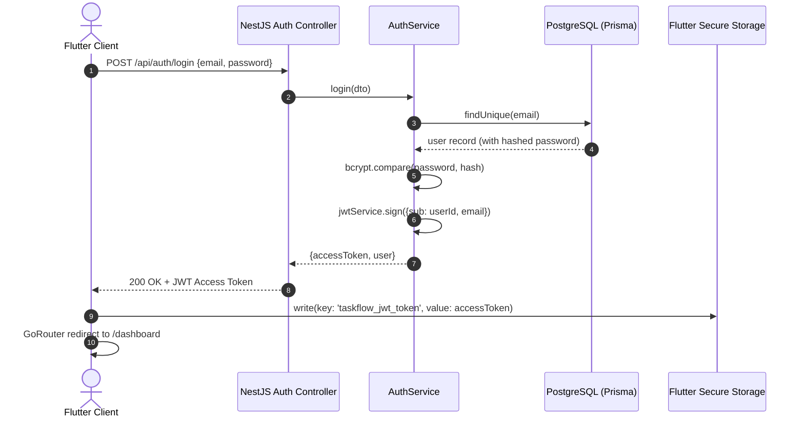

# TaskFlow – Technical Interview Master Guide

> **Project Name:** TaskFlow – Smart Team & Project Management  
> **Candidate:** Mahmoud Abdalrahman Mohamed  
> **Stack:** Flutter (Dart, Riverpod, GoRouter, Dio, Material 3) + NestJS (TypeScript, Prisma ORM, PostgreSQL, JWT, Swagger)  
> **Repositories:**
> - Flutter Frontend: [https://github.com/MahmoudAbdalrhmanMohamed/taskflow-flutter](https://github.com/MahmoudAbdalrhmanMohamed/taskflow-flutter)
> - NestJS Backend: [https://github.com/MahmoudAbdalrhmanMohamed/taskflow-nestjs-api](https://github.com/MahmoudAbdalrhmanMohamed/taskflow-nestjs-api)

---

## 1. Project Overview

**TaskFlow** is a production-grade full-stack project and team management SaaS application designed for cross-functional agile engineering teams. 
It enables teams to:
- Organize projects with custom theme colors and icons.
- Track real-time completion analytics, overdue deadlines, and priority distributions.
- Manage tasks across list and visual **Kanban Board** workflows (`To Do` → `In Progress` → `Done`) with optimistic status synchronization.
- Maintain secure stateless session handling via JWT and Encrypted Secure Storage.

---

## 2. Why Flutter & NestJS Were Selected

### Why Flutter?
1. **Single High-Performance Codebase**: Flutter renders directly to Skia / Impeller canvas, achieving 60/120 FPS across iOS, Android, Tablet, Web, and Desktop.
2. **Material 3 Design System**: Native tokens for dynamic color palettes, tonal elevation, and responsive navigation rails.
3. **Declarative State with Riverpod**: Compile-safe dependency injection without `BuildContext` coupling, enabling testable and maintainable state.

### Why NestJS?
1. **Opinionated Enterprise Architecture**: Enforces modularity through Modules, Controllers, Services, and Dependency Injection, eliminating spaghetti backend logic.
2. **First-Class TypeScript Support**: Full type safety from database models (Prisma) through DTOs (`class-validator`) to controller response contracts.
3. **Ecosystem & OpenAPI**: Seamless swagger specification generation, Passport JWT integration, and predictable pipeline processing with interceptors and filters.

---

## 3. Flutter Architecture (Pragmatic Clean Feature-First)

The frontend follows a **feature-first clean architecture**:

```
lib/
├── core/                       # Shared across all features
│   ├── config/                 # Environment endpoints & timeout parameters
│   ├── constants/              # Theme palette (Indigo & Violet), text styles
│   ├── network/                # Centralized Dio ApiClient & error interceptors
│   ├── routing/                # GoRouter with authentication guards & redirect logic
│   ├── theme/                  # Material 3 Light and Dark ThemeData
│   └── widgets/                # Reusable UI primitives (CustomButton, StatusChip, StatCard)
├── features/                   # Self-contained domain & UI slices
│   ├── auth/                   # Login, Register, AuthNotifier, UserModel
│   ├── dashboard/              # Aggregated metrics, progress gauges, activity feeds
│   ├── projects/               # Project listing, detail view, creation modal, repository
│   ├── tasks/                  # Task CRUD, filters, Kanban drag-and-drop board
│   └── profile/                # Profile management & dynamic server environment switcher
└── shared/
    └── widgets/                # AppScaffold with responsive NavigationBar / NavigationRail
```

**Key Architectural Decisions:**
- **Separation of Concerns**: UI widgets only trigger notifier actions and read state; network logic is isolated in repositories; HTTP transformations are centralized in `ApiClient`.
- **Adaptability**: `AppScaffold` dynamically switches from `NavigationBar` on phones (`width < 720dp`) to `NavigationRail` on tablets/desktops.

---

## 4. Riverpod State Management

### Riverpod 2.x Patterns Used:
1. **`StateNotifierProvider`**:
   - `authProvider`: Manages `AuthState` (`isInitialized`, `isAuthenticated`, `user`, `isLoading`, `errorMessage`).
   - `projectsProvider`: Manages project collections, active project selection, and real-time calculation of completed task counts.
   - `tasksProvider`: Manages task collections, multi-dimensional filters (`projectId`, `status`, `priority`, `search`), and optimistic updates.
2. **Optimistic Updates**:
   When a card is moved between Kanban columns, `tasksProvider.updateTaskStatus` updates the UI state immediately and issues the background API request. If the network call fails, the state automatically rolls back and notifies the user with a SnackBar.
3. **No Service Locator Antipattern**:
   Repositories and ApiClients are injected through Riverpod `Provider<T>`, allowing painless unit testing with mocked providers.

---

## 5. REST API Integration & Dio

1. **Centralized Client (`ApiClient`)**:
   Built on `Dio` with a 15-second connection and receive timeout.
2. **Token Interceptor**:
   Injects `Authorization: Bearer <token>` on every outgoing HTTP request by reading securely from `flutter_secure_storage`.
3. **Error Normalization (`ApiException`)**:
   Dio exceptions (`badResponse`, `connectionTimeout`, `connectionError`) are normalized into structured user-friendly exceptions that display meaningful backend validation messages.
4. **Dynamic API Endpoint Switcher**:
   The user or interviewer can switch between `Localhost`, `Android Emulator (10.0.2.2)`, or `Render Production URL` in the Settings tab in 1 click without rebuilding the application.

---

## 6. JWT Authentication Flow



- Passwords hashed using salted `bcryptjs` (cost factor 10).
- Passport `JwtStrategy` validates bearer tokens on protected routes.
- `@Public()` decorator bypasses auth guard for `/api/auth/register`, `/api/auth/login`, and `/health`.

---

## 7. PostgreSQL Relational Schema & Prisma ORM

### Entity Relationships:
`User (1) ────< Project (N) ────< Task (N)`

```prisma
model User {
  id         String    @id @default(uuid())
  email      String    @unique
  password   String
  name       String
  projects   Project[]
  tasks      Task[]
}

model Project {
  id          String   @id @default(uuid())
  name        String
  color       String   @default("#6366F1")
  ownerId     String
  owner       User     @relation(fields: [ownerId], references: [id], onDelete: Cascade)
  tasks       Task[]
  @@index([ownerId])
}

model Task {
  id          String    @id @default(uuid())
  title       String
  status      String    @default("TODO")
  priority    String    @default("MEDIUM")
  dueDate     DateTime?
  order       Int       @default(0)
  projectId   String
  project     Project   @relation(fields: [projectId], references: [id], onDelete: Cascade)
  userId      String
  user        User      @relation(fields: [userId], references: [id], onDelete: Cascade)
  @@index([projectId])
  @@index([userId])
  @@index([status])
}
```

**Optimization & Integrity:**
- **UUID Primary Keys**: Prevents enumeration attacks.
- **Cascade Deletion**: Removing a project automatically purges orphan tasks.
- **Indexes**: Indexed on `ownerId`, `projectId`, `userId`, and `status` to ensure fast query response times under high task counts.

---

## 8. Error Handling & Validation Strategy

1. **DTO Validation (`class-validator`)**:
   All incoming payloads are strictly validated before hitting controller logic. Non-whitelisted fields are stripped automatically.
2. **Centralized Exception Filter (`HttpExceptionFilter`)**:
   Standardized JSON response envelope across all HTTP errors:
   ```json
   {
     "statusCode": 400,
     "error": "Bad Request",
     "message": ["Password must be at least 6 characters long"],
     "timestamp": "2026-10-13T20:00:00.000Z",
     "path": "/api/auth/register"
   }
   ```
3. **Tenant Ownership Verification**:
   Controllers verify that the `userId` in the JWT matches the `ownerId` of the project or task. Attempting to query another user's project returns `403 Forbidden` or `404 Not Found`.

---

## 9. Security Decisions

1. **Encrypted Client Token Storage**: Tokens are stored using AES-encrypted hardware-backed storage (`flutter_secure_storage` via Keychain on iOS and KeyStore on Android).
2. **CORS Hardening**: Explicit CORS configuration allowing mobile clients and cross-origin preflight requests.
3. **Stateless Scalability**: No session state is retained in server memory; authentication is validated purely cryptographically via signed JWTs.
4. **Zero Secret Leaks**: All credentials, database connection strings, and JWT secrets are managed strictly through environment variables.

---

## 10. Deployment Architecture

- **Containerization**: Multi-stage `Dockerfile` creating an Alpine Linux runtime container.
- **Render Blueprint (`render.yaml`)**:
  - Automatically provisions a free-tier Node.js Web Service and a managed PostgreSQL instance.
  - Automatically executes `npx prisma migrate deploy` upon deployment.
- **CI/CD**: GitHub Actions workflows on both repositories validate builds and test suites on every pull request and push to `main`.
- **Free-Tier Considerations**: Render free tier web services spin down after 15 minutes of inactivity; initial cold start takes approximately 30-50 seconds.

---

## 11. Future Scalability Improvements

1. **WebSockets / Server-Sent Events (SSE)**: Enable live multiplayer board updates so when teammate A moves a card, teammate B sees the card move in real time.
2. **Redis Caching**: Cache aggregated dashboard metrics (`/api/dashboard/stats`) with 60-second TTL to reduce database query load.
3. **Offline-First Synchronization**: Integrate local SQLite (`drift` or `hive`) on the Flutter client with bidirectional sync queues for offline work.
4. **Role-Based Access Control (RBAC)**: Support team organizations with `ADMIN`, `MEMBER`, and `VIEWER` permissions.

---

## 12. Five Realistic Technical Interview Questions & Strong Answers

### Q1: "Why did you choose Riverpod over Bloc or Provider for state management?"
> **Answer:** "Provider relies heavily on `BuildContext`, making it difficult to read state outside widgets (such as in navigation guards or background interceptors). Bloc provides great structure, but introduces substantial boilerplate for straightforward CRUD applications. Riverpod 2.x solves both: it is compile-safe, does not require `BuildContext`, allows granular reactivity with `ref.watch`, and provides clean dependency injection that makes mocking and unit testing trivial without ceremony."

### Q2: "How do you handle optimistic UI updates on the Kanban board, and what happens if the network fails?"
> **Answer:** "In `tasks_provider.dart`, when a user drags a task card to a new column, the notifier immediately creates a copy of the state and updates the task's status in memory. The UI renders the change in 0ms. In parallel, an asynchronous PATCH request is sent to `/api/tasks/:id`. If the network request fails, the catch block restores the previous task list snapshot and surfaces an informative SnackBar to the user. This gives users a snappy experience while guaranteeing data consistency with PostgreSQL."

### Q3: "How does your NestJS backend prevent User A from modifying User B's tasks?"
> **Answer:** "Every protected endpoint extracts the authenticated user's ID directly from the validated JWT payload using the custom `@CurrentUser('id')` decorator. In `TasksService` and `ProjectsService`, all database queries enforce multi-tenant isolation with `where: { id, userId }` or by validating that `project.ownerId === userId` before creating or modifying tasks. If a user attempts to access an ID they do not own, the service throws a `ForbiddenException`."

### Q4: "How does your Flutter app handle responsive design between a phone and a tablet?"
> **Answer:** "We use `LayoutBuilder` at the scaffold and view levels. In `AppScaffold`, if the screen width is below 720dp (standard mobile), it renders a bottom `NavigationBar`. If the screen width exceeds 720dp (tablet, foldable, desktop), it switches to a left `NavigationRail`. In the Kanban board, wide screens display all three columns side-by-side with drag targets, while compact mobile screens present a smooth `TabBarView` where users swipe between columns."

### Q5: "How does Prisma handle migrations between development and production environments?"
> **Answer:** "During development, we use `npx prisma migrate dev`, which compares `schema.prisma` against the local database, creates incremental SQL migration files in `prisma/migrations`, and updates the Prisma Client. For production (such as Docker or Render deployment), we execute `npx prisma migrate deploy` in the start script. This applies all pending unapplied migration scripts without creating new migration files, ensuring idempotent, safe deployments."

---

## 🎙️ 2-Minute Interview Presentation Script

> "Good morning / afternoon! Today I'm excited to present **TaskFlow**, a full-stack project and team management SaaS application that I built using **Flutter** on the frontend and **NestJS with PostgreSQL** on the backend.
>
> When designing TaskFlow, my goal was to demonstrate production-grade architecture on both ends. 
> 
> On the backend, I built a modular NestJS API with TypeScript and Prisma ORM. It features stateless JWT authentication, password hashing with bcrypt, declarative class validation, centralized exception filters, and automated Swagger OpenAPI documentation at `/api/docs`. The database models follow clean relational design with foreign key constraints, cascade deletions, and index optimizations.
> 
> On the frontend, I used Flutter with Riverpod 2.x and GoRouter. The application uses a feature-first clean architecture. The UI is built with Google's Material 3 design system in an elegant indigo and violet palette, featuring:
> - An executive dashboard with real-time project metrics, completion rates, and upcoming deadlines.
> - Full project and task CRUD with instant multi-criteria filtering and search.
> - An interactive 3-column drag-and-drop Kanban board with optimistic updates.
> - An account settings screen featuring a dynamic API environment switcher that lets you switch between Localhost and Cloud production with one click.
> 
> Both repositories are publicly available on GitHub with automated CI/CD workflows, comprehensive documentation, and clean unit and widget test coverage. 
> 
> I'd love to walk you through a live demonstration of the app!"
